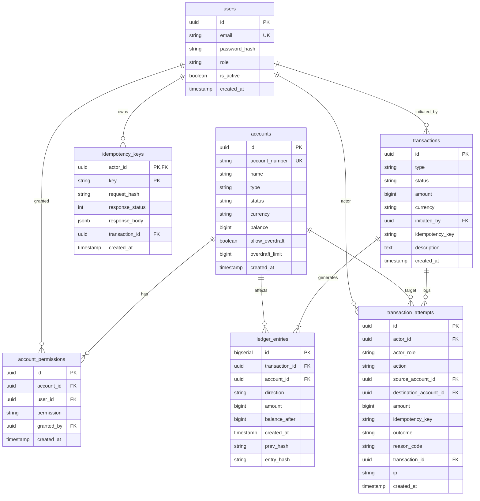

# LedgerLine Database Architecture & Schema Specification

LedgerLine is a concurrency-safe, tamper-evident double-entry financial ledger backed by PostgreSQL 15+. The database schema enforces strict mathematical conservation of money, append-only immutability, cryptographic hash chaining, and row-level pessimistic locking.

---

## 1. Entity-Relationship Diagram



---

## 2. Double-Entry Accounting Invariants & Conventions

### 2.1 Integer Minor Units (Cents)
All financial amounts are stored as **integer minor units** (`BIGINT` cents). Floating-point representations (`FLOAT`, `REAL`, `DOUBLE PRECISION`) are prohibited across the application and database schemas. For instance, \$100.00 is strictly stored as `10000`.

### 2.2 Balance Update Formulas
For every account in the system:
$$\Delta \text{Balance} = \begin{cases} +\text{amount} & \text{if Direction} = \text{CREDIT} \\ -\text{amount} & \text{if Direction} = \text{DEBIT} \end{cases}$$

Running balance (`balance_after`) is recorded directly on each `ledger_entries` record and represents the balance of the affected account immediately following the entry.

### 2.3 Counterparty Model via System Accounts
System accounts (specifically `CASH_VAULT`) act as the balanced counterparty for external capital flows:
1. **DEPOSIT**: Customer injects external cash.
   - Cash Vault (Asset): `DEBIT` (-amount)
   - Customer Account (Liability): `CREDIT` (+amount)
   - Net System Change: $(-A) + (+A) = 0$
2. **WITHDRAWAL**: Customer removes cash.
   - Customer Account: `DEBIT` (-amount)
   - Cash Vault: `CREDIT` (+amount)
   - Net System Change: $(-A) + (+A) = 0$
3. **TRANSFER**: Peer-to-peer transfer.
   - Source Customer: `DEBIT` (-amount)
   - Destination Customer: `CREDIT` (+amount)
   - Net System Change: $(-A) + (+A) = 0$

### 2.4 Global Conservation Invariant
Because every transaction $T$ satisfies $\sum \text{debits} == \sum \text{credits}$, the global sum of all balances in the system (including customer deposits and system cash vaults) is **strictly conserved and sums to zero**:
$$\sum_{a \in \text{Accounts}} \text{balance}(a) = 0$$

---

## 3. Database Constraints

### 3.1 Overdraft Protection Constraints (`accounts` table)
```sql
CONSTRAINT chk_account_balance_overdraft CHECK (balance >= -overdraft_limit)
CONSTRAINT chk_account_balance_positive CHECK (allow_overdraft OR balance >= 0)
```
- Non-overdraft customer accounts (`allow_overdraft = false`) can never drop below zero.
- Overdraft accounts (`allow_overdraft = true`) can drop down to `-overdraft_limit`, but not a single cent further.
- Prevents balance anomalies at the database kernel level, even if the application layer were bypassed.

### 3.2 Immutability of Financial Records
- Positive transaction amount constraint: `CHECK (amount > 0)` on `transactions` and `ledger_entries`.
- Valid roles: `CHECK (role IN ('ADMIN', 'ACCOUNT_HOLDER', 'AUDITOR'))`.
- Valid account statuses: `CHECK (status IN ('ACTIVE', 'FROZEN', 'CLOSED'))`.
- Valid attempt outcomes: `CHECK (outcome IN ('SUCCESS', 'REFUSED', 'FAILED', 'REPLAYED'))`.

---

## 4. PostgreSQL Triggers

### 4.1 Append-Only Immutability Triggers
To guarantee that financial records are tamper-proof and cannot be erased or manipulated:
- **`trg_ledger_entries_immutable`**: `BEFORE UPDATE OR DELETE ON ledger_entries FOR EACH ROW` $\rightarrow$ raises exception.
- **`trg_ledger_entries_no_truncate`**: `BEFORE TRUNCATE ON ledger_entries` $\rightarrow$ raises exception.
- **`trg_transactions_immutable`**: `BEFORE UPDATE OR DELETE ON transactions FOR EACH ROW` $\rightarrow$ raises exception.
- **`trg_transactions_no_truncate`**: `BEFORE TRUNCATE ON transactions` $\rightarrow$ raises exception.
- **`trg_attempts_immutable`**: `BEFORE UPDATE OR DELETE ON transaction_attempts FOR EACH ROW` $\rightarrow$ raises exception.

### 4.2 Deferred Double-Entry Balance Verification Trigger
```sql
CREATE CONSTRAINT TRIGGER trg_ledger_entries_balanced
AFTER INSERT ON ledger_entries
DEFERRABLE INITIALLY DEFERRED
FOR EACH ROW
EXECUTE FUNCTION verify_transaction_balanced();
```
- Evaluated at transaction **commit** time.
- Queries `ledger_entries` for `NEW.transaction_id`:
  $$\sum \text{amount}_{\text{DEBIT}} - \sum \text{amount}_{\text{CREDIT}} == 0$$
- If unbalanced, the transaction is rejected and automatically rolled back by PostgreSQL.

---

## 5. Tamper-Evident SHA-256 Hash Chaining

Each record in `ledger_entries` is linked to the previous entry via a cryptographic SHA-256 hash chain:
$$\text{entry\_hash} = \text{SHA256}(\text{prev\_hash} \parallel \text{id} \parallel \text{transaction\_id} \parallel \text{account\_id} \parallel \text{direction} \parallel \text{amount} \parallel \text{balance\_after} \parallel \text{created\_at})$$

1. **Genesis Entry**: The initial entry in the ledger links to `GENESIS_HASH`:
   `0000000000000000000000000000000000000000000000000000000000000000`
2. **Deterministic Sequence**: Sequence `ledger_entries_id_seq` pre-fetches the unique primary key, allowing `entry_hash` to be computed and inserted without triggering update blocks.
3. **Chain Verification**: `/api/v1/audit/verify-chain` verifies every link in linear sequence. Any unauthorized modification or row deletion produces an immediate mismatch.
